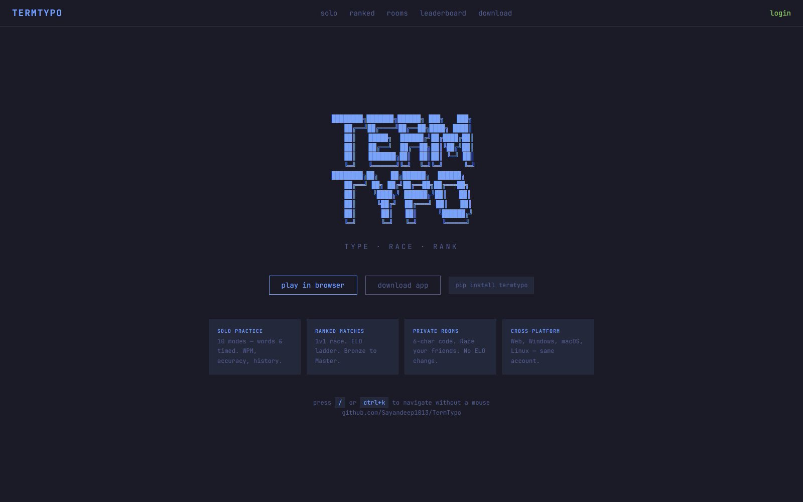
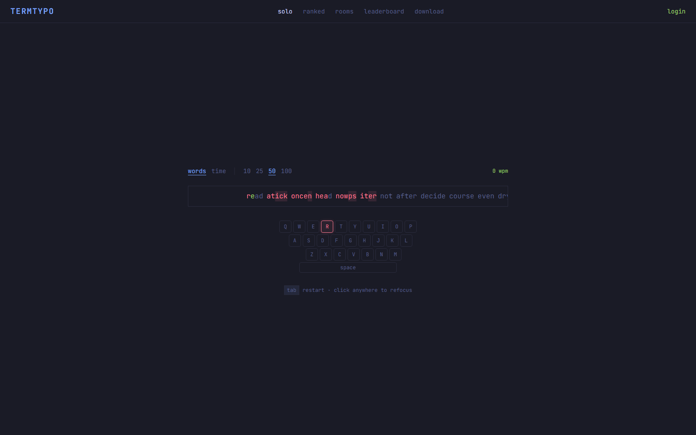
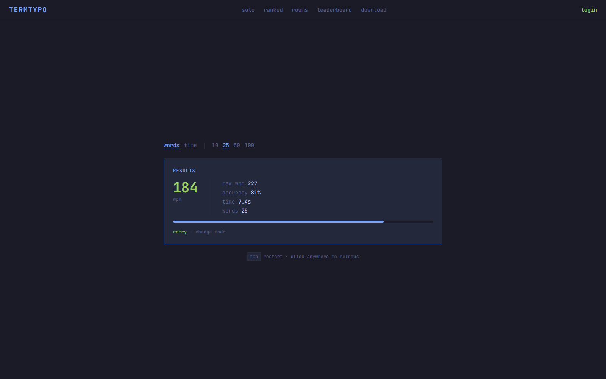

<div align="center">

```
████████╗███████╗██████╗ ███╗   ███╗
   ██╔══╝██╔════╝██╔══██╗████╗ ████║
   ██║   █████╗  ██████╔╝██╔████╔██║
   ██║   ██╔══╝  ██╔══██╗██║╚██╔╝██║
   ██║   ███████╗██║  ██║██║ ╚═╝ ██║
   ╚═╝   ╚══════╝╚═╝  ╚═╝╚═╝     ╚═╝
████████╗██╗   ██╗██████╗  ██████╗
   ██╔══╝╚██╗ ██╔╝██╔══██╗██╔═══██╗
   ██║    ╚████╔╝ ██████╔╝██║   ██║
   ██║     ╚██╔╝  ██╔═══╝ ██║   ██║
   ██║      ██║   ██║     ╚██████╔╝
   ╚═╝      ╚═╝   ╚═╝      ╚═════╝
```

**A terminal-first multiplayer typing test.**  
Ranked 1v1 matches, live races, ELO ladder, and a global leaderboard — all inside your terminal.

[](https://pypi.org/project/termtypo/)
[](https://www.python.org/)
[](LICENSE)

</div>

---

## Screenshots

Web app, solo practice mode:

| Landing | Live typing | Results |
|---|---|---|
|  |  |  |

---

## Install

**With pip (recommended):**
```bash
pip install termtypo
termtypo
```

**Direct download (no Python needed):**  
Grab the latest binary for your platform from [Releases](https://github.com/Sayandeep1013/TermTypo/releases).

---

## Features

### Solo Practice
- Scrolling single-line display — cursor stays pinned at center as text flows past
- Live keyboard visualization highlights each keystroke green (correct) or red (wrong)
- Word modes: **10 / 25 / 50 / 100** words
- Timed modes: **10s / 30s / 60s**
- Results modal: WPM, raw WPM, accuracy, time, word count
- Cycle modes with `←` `→` without leaving the screen

### Ranked Matchmaking
- Automatic 1v1 pairing — enter the queue, get matched instantly
- Cross-platform: terminal players can race against browser players
- ELO ladder with 7 separate mode ratings
- Results saved to your profile

### Private Rooms
- Create a room, share the 6-character code with a friend
- Choose the mode before the race starts
- No ELO change — just for fun

### Live Race
- Real-time opponent progress bar updates every 200ms
- Race header shows elapsed time and live WPM
- Auto-win if opponent disconnects for 45+ seconds

### Leaderboard
- Top players per mode (words_10 through time_60)
- Shows ELO, rank, wins, losses, and W/L ratio

### Profile & Stats
- Personal best WPM
- ELO and rank per mode with progress bar
- Recent solo results history
- Google login via browser OAuth (optional — guest mode available for solo)

---

## Controls

### Main Menu

| Key | Action |
|-----|--------|
| `s` | Solo Practice |
| `r` | Ranked Match |
| `c` | Create Room |
| `j` | Join Room |
| `l` | Leaderboard |
| `a` | Profile / Login |
| `q` | Quit |

### Typing

| Key | Action |
|-----|--------|
| `Tab` | Restart test |
| `← →` | Cycle through modes |
| `Esc` | Back to menu |
| `Backspace` | Delete last character (works across word boundaries) |
| `Ctrl+Backspace` | Clear current word |
| `Space` | Advance to next word |

---

## Ranking System

ELO is tracked separately for each of the 7 modes.

| Tier | ELO Range |
|------|-----------|
| Bronze | 0 – 299 |
| Silver | 300 – 599 |
| Gold | 600 – 899 |
| Platinum | 900 – 1199 |
| Diamond | 1200 – 1499 |
| Master | 1500+ |

Each win/loss adjusts ELO by ±30. Floor is 0.

---

## Web App

A companion web interface is available for players who prefer the browser. It shares the same backend — accounts, ELO, match history, and leaderboards are all unified across terminal and web.

**Pages:**

| Page | Description |
|------|-------------|
| **solo** | Typing test with scrolling display and live keyboard visualization |
| **ranked** | Enter the matchmaking queue — cross-play with terminal clients |
| **rooms** | Create or join a private room by code |
| **leaderboard** | Top players per mode |
| **profile** | Personal best, per-mode ELO with progress bars, recent solo history |
| **download** | Links to the PyPI package and platform binaries |

Profile page shows your rank, ELO progress bar, wins/losses, and a recent solo results table (WPM, raw WPM, accuracy) for each mode. The ranked system is identical to the terminal — matches between terminal and browser clients count for ELO on both sides.

---

## Login

Login is completely optional — solo practice works without an account.

Ranked matches and private rooms require a Google account.  
On first login, your browser opens for Google OAuth. The app starts a temporary local server on `localhost:54321` to receive the callback — no credentials are stored anywhere except your local session file.

---

## Update

The app checks for updates on every launch and notifies you in the status bar.

```bash
pip install --upgrade termtypo
```

---

## License

MIT
